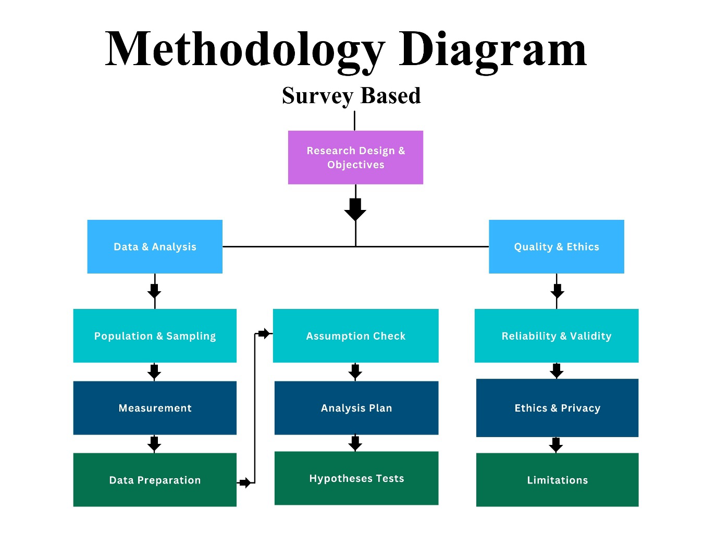
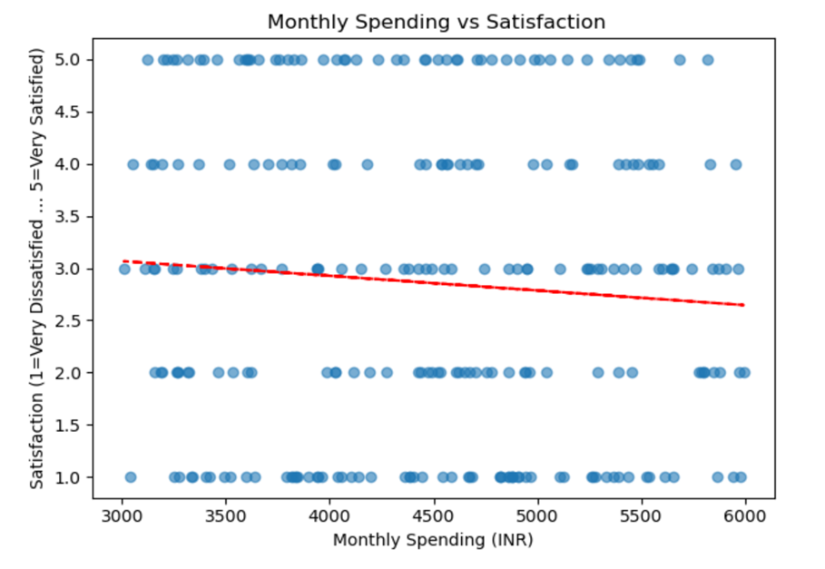
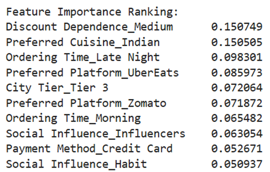

# Consumer Behaviour in Food Delivery: A Study of Indian College Students

**MSc Business Analytics dissertation, Aston University (September 2025)**
**Tools:** Excel (pivot tables, charts), Python (basic, guided: charts and a scikit-learn decision tree)
**Methods:** survey design, data cleaning and coding, hypothesis testing, decision tree classification

---

## The question

Food delivery apps like Swiggy, Zomato and Uber Eats treat students as one big, discount-hungry market. I wanted to test whether that's true. What actually changes how much students spend, how often they order, and how satisfied they are?

## The data

- **250 college students in India**, collected through my own structured online survey.
- **Variables:** demographics (gender, city tier, living arrangement, employment), behaviour (platform, cuisine, ordering time, frequency, monthly spend) and context (subscription, discount dependence, peer influence, payment method), plus satisfaction on a 1–5 scale.
- Only students who had used a delivery app in the last six months were included. Duplicates and very incomplete responses were removed.
- The raw responses are **not** published, because participants were told their answers would stay private.

## What I did

1. **Built a coding scheme and codebook.** Satisfaction became 1–5, and rare categories were merged so chi-square tests had enough counts.
2. **Checked test assumptions** (normality with histograms and Shapiro-Wilk, equal variances, expected counts) and switched to non-parametric tests where they failed.
3. **Mapped 12 hypotheses to the right test:** independent t-test, Mann-Whitney U, chi-square with Cramér's V, one-way ANOVA, Spearman's rho and Fisher's exact test. All tests were two-tailed at α = 0.05.
4. **Built a decision tree classifier** on all the predictors to see which factors best explain satisfaction.

## Key results

| # | Hypothesis | Test | Result |
|---|---|---|---|
| H1 | Subscribers spend more per month | t-test | ₹4,521 vs ₹4,412, t = −1.035, p = 0.302, **not significant** |
| H2 | Subscribers are more satisfied | Mann-Whitney U | 2.9 vs 2.8, U = 7541.5, p = 0.627 |
| H3 | Discount dependence changes order frequency | Chi-square | χ² = 5.72, p = 0.455, V = 0.12 |
| H4 | Payment method changes satisfaction | Chi-square | χ² = 24.66, p = 0.076, V = 0.157 |
| H5 | Platform changes order frequency | Chi-square | χ² = 2.54, p = 0.980 |
| H6 | Living arrangement changes spending | ANOVA | F = 0.798, p = 0.452 |
| H7 | City tier changes order frequency | Chi-square | χ² = 9.93, p = 0.128 |
| H8 | Cuisine changes spending | ANOVA | p = 0.262 |
| H9 | Ordering time changes frequency | Chi-square | χ² = 11.34, p = 0.253 |
| H10 | Higher spend means higher satisfaction | Spearman | ρ = −0.076, p = 0.233 |
| H11 | Employment status changes reason for ordering | Chi-square | χ² = 9.13, p = 0.425 |
| H12 | Peer influence changes cuisine choice | Chi-square / Fisher | p = 0.312 / 0.708 |

**None of the 12 differences was statistically significant.** That was the main finding. For this group of students, spending is capped by budget, and things like platform, payment type, subscription and demographics barely move behaviour.

**Decision tree:** test accuracy was **0.187**, close to chance for 5 satisfaction levels. I report that honestly, because it confirms satisfaction can't be predicted well from these variables. The feature ranking was still useful: discount dependence, Indian cuisine preference and late-night ordering came out on top, and demographics ranked low.

## What it means for the business

- **Reliability beats discounts.** Satisfaction didn't rise with spend or subscriptions, so the experience (on-time delivery, accurate orders, easy checkout) matters more than price cuts.
- **Evening and late night are the busiest windows.** That's where platforms should protect delivery times and give clear ETAs and delay alerts.
- **Discounts and peers trigger one-off orders, not habits.** Use small, targeted, time-boxed offers instead of blanket discounts.
- **Make digital payments fast and frictionless.** Cash users leaned slightly lower on satisfaction, although it wasn't significant.

## Limitations

The survey used convenience and snowball sampling, some constructs were single-item, and the design was cross-sectional, so the results show associations, not causes.

## Files

- `report/`: full dissertation (PDF)
- `images/`: charts from the analysis
- `data/`: list of survey variables (raw responses are kept private)
